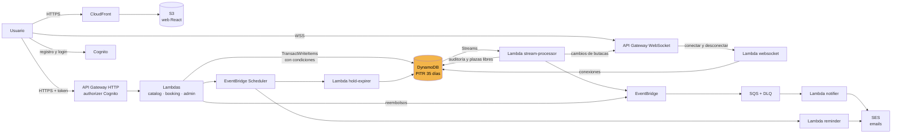

# BookSlot Cinema

Plataforma de reserva de entradas de cine con butacas numeradas y disponibilidad en tiempo real.

- Registro y login con verificación por email.
- Cartelera, sesiones por día y mapa de butacas que se actualiza en vivo.
- Reserva en dos pasos: las butacas quedan retenidas 10 minutos mientras se paga.
- Sin overbooking: si varias personas reservan la misma butaca a la vez, solo una lo consigue.
- Reservas idempotentes: reintentar una reserva no crea otra.
- Cancelación gratuita hasta 2 horas antes de la sesión, con reembolso.
- Emails de confirmación, cancelación y recordatorio.
- Pago simulado, sin cargos reales.
- Panel de administración: películas, salas, sesiones, bloqueo de sesiones y auditoría de reservas.

Backend en TypeScript sobre AWS Lambda y DynamoDB, frontend en React y la infraestructura en Terraform.

## Arquitectura



El **control de concurrencia ocurre en DynamoDB** (en amarillo), dentro de una transacción que lanza la Lambda `booking`. Las Lambdas no guardan estado ni usan locks en memoria.

Además:

- **Logs y alarmas:** CloudWatch Logs para todas las Lambdas y la API. Hay alarmas de errores de Lambda, 5xx de la API, throttling de DynamoDB y mensajes en las colas de error, que avisan por email con SNS.
- **Costes:** AWS Budgets con avisos al 50, 80 y 100 %.
- **Despliegue:** CodePipeline + CodeBuild despliegan en cada push a `main`.

## Decisión arquitectónica

### Stack: serverless

API Gateway + Lambda (Node.js 24) + DynamoDB on-demand, con Cognito, SES, EventBridge, SQS y Scheduler.

- **Alta disponibilidad:** todos los servicios son regionales y multi-AZ sin configurar nada.
- **Coste:** en reposo es casi cero y solo se paga por uso.
- **Escalado:** escala solo ante un pico de reservas, por ejemplo un estreno.
- **Concurrencia:** DynamoDB ofrece transacciones con condiciones por ítem, que es justo lo que hace falta para evitar el overbooking sin gestionar locks.

### Cómo se evita el overbooking

Cada butaca de cada sesión es un ítem en DynamoDB con su estado: `AVAILABLE`, `HELD` o `BOOKED`. Reservar es una única `TransactWriteItems` ([backend/src/modules/holds/holds.transactions.ts](backend/src/modules/holds/holds.transactions.ts)) que hace, **todo o nada**:

1. Cambia cada butaca de `AVAILABLE` a `HELD`, **con la condición** de que siga libre (o retenida por una reserva ya caducada).
2. Guarda la clave de idempotencia, con la condición de que no exista.
3. Crea la reserva temporal.

Si dos personas piden la misma butaca a la vez, DynamoDB serializa las escrituras sobre ese ítem: la primera transacción se aplica y la segunda falla la condición y se cancela entera. Esa persona recibe `409 SOLD_OUT` ("lo sentimos, se ha agotado").

Para que las reservas de un estreno no choquen entre sí, no se usa un contador global de plazas dentro de la transacción. El contador de plazas libres lo recalcula después el stream-processor.

El pago (`HELD → BOOKED`) es otra transacción, condicionada a que las butacas sigan siendo de esa reserva temporal. Si caducó y otra persona se quedó la butaca, el pago se reembolsa.

### Idempotencia

`POST /shows/{id}/holds` exige la cabecera `Idempotency-Key`. La clave se guarda en la misma transacción que la reserva, así que dos reintentos simultáneos no pueden crear dos reservas: el segundo recibe la reserva original.

### Prueba de concurrencia

[scripts/concurrency-test.sh](scripts/concurrency-test.sh) lanza N reservas simultáneas con `curl` + `xargs -P` sobre una sala de M butacas (N > M). Salida en [docs/concurrency-test-output.txt](docs/concurrency-test-output.txt):

```
Aceptadas (201):      20  (esperado 20)
Agotadas (409):       80  (esperado 80)
Butacas duplicadas:   0
RESULTADO: OK, sin overbooking
```

### Backups

- **DynamoDB:** Point-in-Time Recovery (PITR) activado, que permite restaurar la tabla a cualquier segundo de los últimos 35 días.
- **Estado de Terraform:** se guarda en un bucket S3 con versionado.

## Requisitos

- Node 24 y pnpm
- Docker
- Para desplegar: Terraform ≥ 1.10, AWS CLI v2 y una cuenta de AWS

## Levantar en local

```bash
corepack enable
pnpm install
docker compose up -d
pnpm dev:api
pnpm seed
pnpm dev:web
```

- Web: http://localhost:5173
- API: http://localhost:3000
- Emails (Mailpit): http://localhost:8025
- Tabla de DynamoDB: http://localhost:8001

En el login hay accesos rápidos de demo para cliente y administrador.

## Tests

```bash
pnpm test
pnpm test:integration
N=100 M=20 scripts/concurrency-test.sh
```

## Despliegue en AWS

La cuenta usada es de laboratorio. Solo permite crear roles IAM con prefijo `student-` y con el permissions boundary `StudentBoundary`. Ambos están configurados como valores por defecto en Terraform.

### 1. Bucket del estado de Terraform (una vez)

```bash
cd infra/bootstrap
cp terraform.tfvars.example terraform.tfvars
terraform init && terraform apply
```

### 2. Aplicación

```bash
cd infra/envs/prod
cp terraform.tfvars.example terraform.tfvars    # owner, alarm_email, sender_email
pnpm install && pnpm --filter @bookslot/backend build
terraform init -backend-config="bucket=bookslot-tfstate-<account_id>"
terraform apply
```

Llegan dos emails que hay que confirmar: la suscripción a las alarmas (SNS) y la verificación del remitente (SES).

### 3. Web

```bash
scripts/deploy-frontend.sh
```

La URL pública sale en `terraform output web_url`.

### 4. Datos de ejemplo y administrador

```bash
DYNAMODB_ENDPOINT= TABLE_NAME=bookslot-prod pnpm seed

POOL=$(terraform -chdir=infra/envs/prod output -raw user_pool_id)
aws cognito-idp admin-create-user --user-pool-id $POOL --username <email> \
  --user-attributes Name=email,Value=<email> Name=email_verified,Value=true --message-action SUPPRESS
aws cognito-idp admin-set-user-password --user-pool-id $POOL --username <email> --password <password> --permanent
aws cognito-idp admin-add-user-to-group --user-pool-id $POOL --username <email> --group-name admin
```

El seed crea sesiones para los próximos 7 días. Pasada esa semana, hay que crear sesiones nuevas desde el panel de administración.

### 5. CI/CD

```bash
cd infra/cicd
cp terraform.tfvars.example terraform.tfvars
terraform init -backend-config="bucket=bookslot-tfstate-<account_id>"
terraform apply
```

Después hay que aprobar la conexión `bookslot-github` en la consola de AWS (Developer Tools → Connections). A partir de ahí, cada push a `main` ejecuta [buildspec.yml](buildspec.yml):

1. typecheck y tests;
2. build de las Lambdas;
3. `terraform apply`;
4. publicación de la web;
5. comprobación de `/health`.

El rol del pipeline no puede crear ni modificar roles IAM por el boundary del laboratorio. Los cambios de permisos se aplican en local con `terraform apply`.

## Coste mensual estimado

Uso de un proyecto académico en eu-west-1:

| Servicio | Coste |
|---|---|
| Lambda, API Gateway, DynamoDB, SQS, EventBridge, Scheduler, SES, SNS | Por uso; dentro de la capa gratuita |
| Cognito | Gratis hasta 10.000 usuarios activos al mes |
| CloudFront y S3 | Dentro de la capa gratuita |
| CodeBuild | 100 minutos gratis al mes; cada despliegue tarda ~2 min |
| CodePipeline V2 | ~0,002 $ por minuto de ejecución |
| CloudWatch: 13 alarmas (10 gratis) y logs | ~0,50 $ |
| DynamoDB PITR | Céntimos (la tabla ocupa pocos MB) |
| **Total** | **~1 $/mes** |

El presupuesto de AWS Budgets está en 10 $/mes.

## Destrucción

En orden inverso al despliegue:

```bash
cd infra/cicd && terraform destroy

cd ../envs/prod
pnpm --filter @bookslot/backend build
terraform apply -var deletion_protection=false
terraform destroy -var deletion_protection=false

cd ../../bootstrap
B=$(terraform output -raw state_bucket)
aws s3api delete-objects --bucket $B --delete "$(aws s3api list-object-versions --bucket $B \
  --query '{Objects: [Versions, DeleteMarkers][][].{Key: Key, VersionId: VersionId}}' --output json)"
terraform destroy
```

`deletion_protection` protege la tabla y Cognito ante un borrado accidental, así que hay que desactivarlo antes del `destroy`. El bucket del estado tiene versionado y hay que vaciarlo antes de destruirlo.
